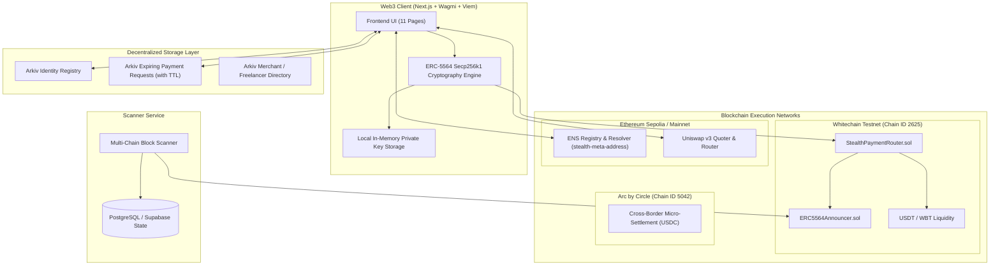
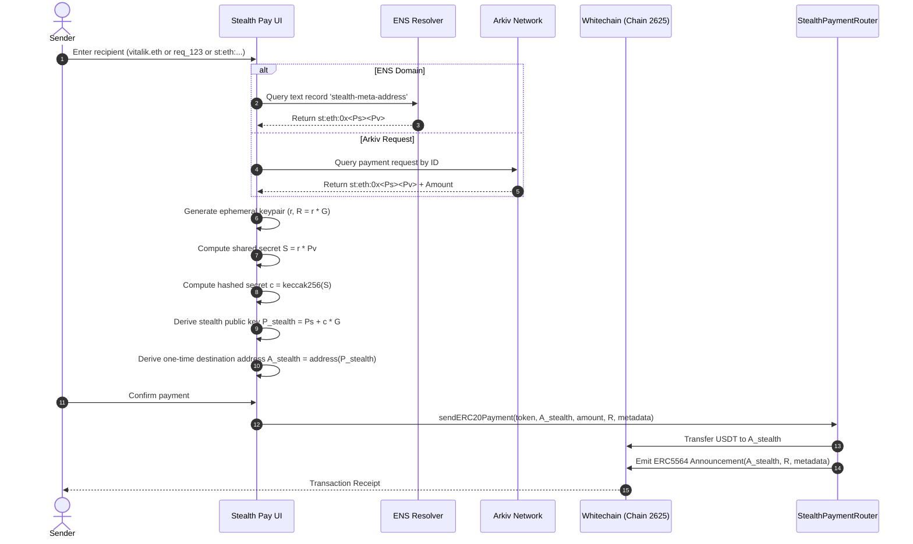
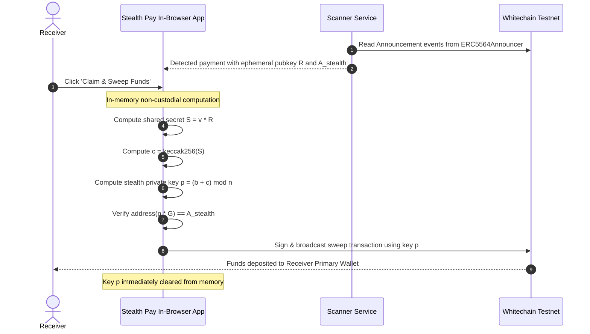

# Stealth Pay — Architecture Specification

## 1. System Architecture Overview

Stealth Pay combines **EIP-5564 stealth addresses** with **Arkiv decentralized storage**, **Whitechain high-throughput execution**, **ENS identity resolution**, and **Uniswap v3 liquidity routing**.

---

## 2. Cryptographic Flow (ERC-5564)

### Receiver Setup
1. Receiver generates two private keypairs on secp256k1 curve:
   - **Spending Keypair:** $(b, P_s)$ where $P_s = b \cdot G$
   - **Viewing Keypair:** $(v, P_v)$ where $P_v = v \cdot G$
2. Receiver forms their permanent **Stealth Meta-Address**:
   $$\text{metaAddress} = \text{"st:eth:0x"} \parallel \text{hex}(P_s) \parallel \text{hex}(P_v)$$
   *(Total length: 141 characters)*
3. Receiver shares this meta-address publicly, publishes it to Arkiv, or binds it to their ENS name as a `stealth-meta-address` text record.

### Payment Execution (Sender)

### Detection & Local Non-Custodial Sweep (Receiver)

---

## 3. Arkiv Decentralized Data Layer Architecture

Arkiv is used to store state that must be decentralized, public, and verifiable without running proprietary backend servers:

1. **Identity Registry (`stealth_identities` collection):**
   - Stores user public profiles with their permanent stealth meta-address.
   - Senders can query identities by display name, category, or public wallet address.
2. **Expiring Payment Requests (`payment_requests` collection):**
   - Senders receive an expirable invoice containing the requested amount, token, network, memo, and recipient stealth meta-address.
   - Leverages Arkiv's time-to-live (TTL) feature to ensure stale or paid invoices automatically purge, avoiding payment errors.
3. **Merchant Directory (`merchant_directory` collection):**
   - Privacy-friendly merchant discovery allowing users to browse services accepting stealth payments.

---

## 4. Whitechain Smart Contract Integration

Whitechain provides low latency (sub-second block time) and low transaction fees, making frequent stealth payments and sweeps economical:

- **Network Name:** Whitechain Testnet
- **Chain ID:** `2625`
- **Native Gas Token:** `WBT` (18 decimals)
- **RPC URL:** `https://rpc-testnet.whitechain.io`
- **Explorer:** `https://testnet.whitechainsentry.com`

### Atomic Execution Architecture
In traditional implementations, payments to stealth addresses and ERC-5564 announcements happen in separate steps, which risks orphaned payments if the announcement fails. `StealthPaymentRouter.sol` ensures atomicity:
- Native WBT transfers: transfer and announcement execute in the same transaction call.
- ERC-20 transfers (USDT): token transfer via `transferFrom` and announcement execute atomically.

---

## 5. ENS & Uniswap v3 Architecture

- **ENS Integration:**
  - Viem client queries Ethereum Mainnet/Sepolia RPC.
  - Reads standard `stealth-meta-address` text record according to EIP-5564.
  - Fallback resolution supports address lookup and avatar resolution.
- **Uniswap v3 Integration:**
  - Before sending a stealth payment, senders can swap any held token (ETH, USDC, WBT) to the receiver's requested asset (USDT).
  - Quotes are calculated with 0.5% maximum slippage protection and displayed directly inside the payment review drawer.
