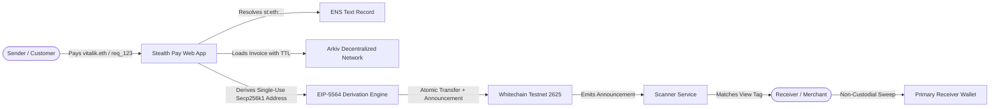

# Stealth Pay — ETHGlobal Mumbai MVP
### Privacy-Preserving Web3 Payments using ERC-5564 Stealth Addresses

[](https://opensource.org/licenses/MIT)
[-blue)](https://testnet.whitechainsentry.com)
[](https://arkiv.network)
[](https://eips.ethereum.org/EIPS/eip-5564)

Stealth Pay is a privacy-preserving cryptocurrency payment platform built for **ETHGlobal Mumbai**. It enables users, merchants, and DAOs to receive cryptocurrency payments without repeatedly exposing their permanent public receiving addresses on-chain.

By utilizing **ERC-5564 stealth addresses**, senders derive unique, unlinkable one-time destination addresses for every payment while receivers retain non-custodial spending control.

---

## 🚀 Key Ecosystem Integrations

1. **Arkiv Network (`@arkiv-network/sdk`):**
   - **Decentralized Identity Registry:** Stores user and merchant profiles without centralized database reliance.
   - **Expiring Payment Requests (with TTL):** Invoices with native time-to-live (1 day, 7 days, 30 days) that automatically expire, preventing phantom payments.
   - **Merchant Directory:** Public directory of privacy-preserving merchants and service providers.
2. **Whitechain Testnet (Chain ID `2625`):**
   - Primary high-speed, low-cost execution network with sub-second finality.
   - Atomic `StealthPaymentRouter.sol` and `ERC5564Announcer.sol` contracts for USDT and native WBT settlement.
3. **Ethereum Name Service (ENS):**
   - Resolves human-readable `.eth` names directly in the payment flow.
   - Queries `stealth-meta-address` text records according to ERC-5564.
4. **Uniswap v3:**
   - Embedded pre-payment token swapping with 0.5% slippage protection for seamless multi-currency settlement.
5. **Arc by Circle (Chain ID `5042`):**
   - Institutional cross-border USDC settlement rail.

---

## 📐 System Architecture



---

## 🛠️ Technology Stack

- **Frontend:** Next.js 14, React 18, Tailwind CSS, Lucide Icons, React Hook Form, Zod.
- **Web3 & Multi-Chain:** Wagmi, Viem, `@noble/curves` (secp256k1), `@noble/hashes`.
- **Decentralized Storage:** `@arkiv-network/sdk`.
- **Smart Contracts:** Solidity `^0.8.20`, OpenZeppelin Contracts.
- **Monorepo:** Turborepo, pnpm workspaces.

---

## 🚀 Quick Start

### 1. Prerequisites
- Node.js `>= 18.17.0`
- `pnpm >= 8.0.0`

### 2. Installation
```bash
git clone https://github.com/vvinit594/Global-Hackathon-Project.git
cd Global-Hackathon-Project
pnpm install
```

### 3. Environment Setup
Copy the sample environment file:
```bash
cp .env.example .env
```

Key environment variables:
```env
# Whitechain Testnet
WHITECHAIN_RPC_URL="https://rpc-testnet.whitechain.io"
WHITECHAIN_CHAIN_ID=2625

# Arkiv Network
ARKIV_NETWORK="testnet"

# Ethereum / ENS / Sepolia
SEPOLIA_RPC_URL="https://rpc.sepolia.org"
```

### 4. Run Development Server
```bash
pnpm dev:web
```
Open [http://localhost:3000](http://localhost:3000) to view the application.

---

## 🧪 Testing & Verification

Run the full monorepo test suite:
```bash
pnpm test
```

Run TypeScript compilation check:
```bash
pnpm typecheck
```

Build production bundle:
```bash
pnpm build:web
```

---

## 📚 Documentation Index
- [`DEVELOPMENT_PROGRESS.md`](DEVELOPMENT_PROGRESS.md) — Comprehensive technical progress and phase logs.
- [`ARCHITECTURE.md`](ARCHITECTURE.md) — System architecture, sequence diagrams, and mathematical specs.
- [`SECURITY.md`](SECURITY.md) — Threat model, non-custodial key custody, and honest privacy disclosure.
- [`docs/arkiv-schema.md`](docs/arkiv-schema.md) — Arkiv entity schemas and validation rules.
- [`docs/arkiv-why.md`](docs/arkiv-why.md) — Architectural rationale for Arkiv over IPFS/Arweave.
- [`docs/arkiv-feedback.md`](docs/arkiv-feedback.md) — Developer experience feedback for the Arkiv team.
- [`docs/arkiv-reach.md`](docs/arkiv-reach.md) — Ecosystem collaboration proposal.
- [`docs/whitechain-integration.md`](docs/whitechain-integration.md) — Whitechain testnet integration details.
- [`docs/ens-integration.md`](docs/ens-integration.md) — ENS text record resolution guide.
- [`docs/uniswap-integration.md`](docs/uniswap-integration.md) — Uniswap v3 pre-payment swap details.
- [`docs/arc-integration.md`](docs/arc-integration.md) — Arc by Circle settlement architecture.

---

## ⚖️ License
MIT License. Built for ETHGlobal Mumbai.
