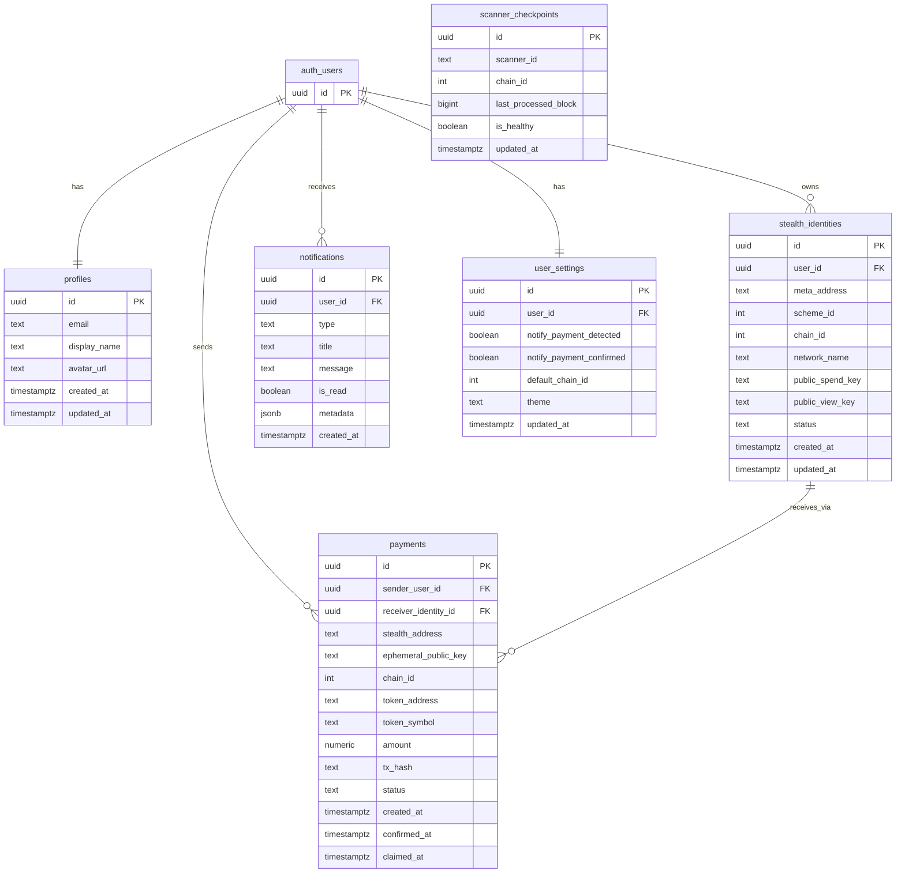

# Stealth Pay — Database Architecture

> Phase 2 deliverable. Documents the full PostgreSQL schema, table design decisions, and migration instructions.

## Overview

The Stealth Pay database runs on **Supabase (PostgreSQL)**. Authentication is handled entirely by Supabase Auth — the application never stores passwords. All user data tables use **Row Level Security (RLS)** so that every row is owned and accessible only by its owning user (or via the service role for background jobs).

Three sequential migrations build the full schema:

| Migration | File | Purpose |
|---|---|---|
| 001 | `001_initial.sql` | Profiles, legacy Bitcoin/BitGo wallets, transactions, detected_payments, scanner_state |
| 002 | `002_bitgo_mpc_wallet_metadata.sql` | Adds BitGo MPC metadata columns to wallets |
| 003 | `003_stealth_pay_ethereum_schema.sql` | **Phase 2** — Ethereum stealth address tables |

---

## Migration Instructions

> [!IMPORTANT]
> No Supabase CLI is installed locally. Apply migrations **manually** using the Supabase SQL Editor.

1. Open your Supabase project → **SQL Editor**
2. Apply migrations **in order** — do not skip or reorder:
   - Paste and run `packages/db/supabase/migrations/001_initial.sql`
   - Paste and run `packages/db/supabase/migrations/002_bitgo_mpc_wallet_metadata.sql`
   - Paste and run `packages/db/supabase/migrations/003_stealth_pay_ethereum_schema.sql`
3. All statements are idempotent (`CREATE TABLE IF NOT EXISTS`, `ADD COLUMN IF NOT EXISTS`, `ON CONFLICT DO NOTHING`), so re-running is safe.

> [!WARNING]
> Never run migrations against a production database without first backing it up and reviewing the SQL carefully.

---

## Table Descriptions

### `profiles` (migration 001 + 003 extension)

Extended profile information for each authenticated user. Created automatically via a PostgreSQL trigger when a new Supabase Auth user is inserted.

| Column | Type | Description |
|---|---|---|
| `id` | uuid PK | Mirrors `auth.users.id` — not auto-generated |
| `email` | text | From Supabase Auth |
| `display_name` | text | Optional UI display name (added in migration 003) |
| `avatar_url` | text | Optional profile image URL (added in migration 003) |
| `created_at` | timestamptz | Auto-set on insert |
| `updated_at` | timestamptz | Auto-updated via trigger |

---

### `wallets` (migrations 001 + 002)

> [!NOTE]
> This is a **legacy** table from the original Bitcoin/BitGo implementation. It is preserved for backward compatibility with the scanner. New Ethereum wallet connections are managed at the application layer using Wagmi — no Ethereum wallet records need to be inserted here.

| Column | Type | Description |
|---|---|---|
| `id` | uuid PK | Auto-generated |
| `user_id` | uuid FK→auth.users | Owning user |
| `label` | text | User-facing wallet name |
| `bitgo_wallet_id` | text UNIQUE | BitGo wallet identifier |
| `network` | text | Bitcoin network (tbtc / btc) |
| `encrypted_view_priv_key` | text | Application-layer encrypted view private key |
| `encrypted_spend_priv_key` | text | Application-layer encrypted spend private key |
| `public_view_key` | text | a·G (33-byte compressed hex) |
| `public_spend_key` | text | b·G (33-byte compressed hex) |
| `wallet_id` | text UNIQUE | BitGo external wallet ID |
| `coin` | text | Coin type (tbtc/btc) |
| `wallet_label` | text | BitGo label |
| `multisig_type` | text | BitGo multisig type |
| `wallet_type` | text | hot/cold/custodial |
| `receive_address` | text | Default receive address |

---

### `stealth_identities` (migration 003)

The core ERC-5564 stealth identity record for a receiver. Stores only **public** key material — no private keys ever.

| Column | Type | Description |
|---|---|---|
| `id` | uuid PK | Auto-generated |
| `user_id` | uuid FK→auth.users | Owning receiver |
| `meta_address` | text UNIQUE | Full ERC-5564 meta-address: `st:eth:0x<Pv><Ps>` |
| `scheme_id` | integer | ERC-5564 scheme (1 = secp256k1 ECDH) |
| `chain_id` | integer | Ethereum chain ID (default 11155111 Sepolia) |
| `network_name` | text | Human-readable network name |
| `public_spend_key` | text | Ps = b·G (33-byte compressed hex, 0x-prefixed) |
| `public_view_key` | text | Pv = a·G (33-byte compressed hex, 0x-prefixed) |
| `status` | text | active / inactive / revoked |
| `created_at` | timestamptz | Auto-set |
| `updated_at` | timestamptz | Auto-updated via trigger |

> [!CAUTION]
> **Never store** the view private key `a` or spend private key `b` in this table. The receiver holds these locally in their wallet.

---

### `payments` (migration 003)

Records each ERC-5564 stealth payment, from preparation through claiming. Distinct from the legacy `transactions` table (which is Bitcoin-based).

| Column | Type | Description |
|---|---|---|
| `id` | uuid PK | Auto-generated |
| `sender_user_id` | uuid FK→auth.users | NULL for anonymous/external senders |
| `receiver_identity_id` | uuid FK→stealth_identities | The receiver's identity |
| `stealth_address` | text | A\_stealth: derived one-time destination address |
| `ephemeral_public_key` | text | R: 33-byte compressed hex (published on-chain) |
| `chain_id` | integer | Chain (default 11155111) |
| `token_address` | text | ERC-20 address; NULL for native ETH |
| `token_symbol` | text | ETH or ERC-20 symbol |
| `token_decimals` | smallint | Decimal precision (18 for ETH) |
| `amount` | numeric(38,0) | Amount in wei — never float |
| `tx_hash` | text UNIQUE | NULL until submitted on-chain |
| `block_number` | bigint | Block of confirmation |
| `block_timestamp` | timestamptz | Block time |
| `status` | text | See lifecycle below |
| `idempotency_key` | text UNIQUE | Client-set deduplication key |
| `note` | text | Optional sender note |
| `created_at` | timestamptz | Auto-set |
| `confirmed_at` | timestamptz | Set when status → confirmed |
| `claimed_at` | timestamptz | Set when status → claimed |

**Payment status lifecycle:**

```
prepared → submitted → confirmed → detected → spendable → claimed
                                                         ↘ failed
```

---

### `notifications` (migration 003)

Per-user notification inbox. Inserted by the backend / scanner worker via the service role.

| Column | Type | Description |
|---|---|---|
| `id` | uuid PK | Auto-generated |
| `user_id` | uuid FK→auth.users | Target user |
| `type` | text | payment\_detected / payment\_confirmed / payment\_claimed / system / scanner\_alert |
| `title` | text | Short notification title |
| `message` | text | Full notification body |
| `is_read` | boolean | Default false |
| `metadata` | jsonb | Flexible payload (payment\_id, tx\_hash, etc.) |
| `created_at` | timestamptz | Auto-set |

---

### `user_settings` (migration 003)

One row per user. Auto-created by trigger on signup. Users can read and update their own row only.

| Column | Type | Description |
|---|---|---|
| `id` | uuid PK | Auto-generated |
| `user_id` | uuid FK→auth.users UNIQUE | One row per user |
| `notify_payment_detected` | boolean | Default true |
| `notify_payment_confirmed` | boolean | Default true |
| `notify_payment_claimed` | boolean | Default true |
| `notify_system` | boolean | Default true |
| `default_chain_id` | integer | Default 11155111 |
| `default_token` | text | Default ETH |
| `theme` | text | light / dark / system (default dark) |
| `created_at` | timestamptz | Auto-set |
| `updated_at` | timestamptz | Auto-updated via trigger |

---

### `scanner_checkpoints` (migration 003)

Global scanner progress state, keyed by `(scanner_id, chain_id)`. **Service role only** — no user-level RLS access.

| Column | Type | Description |
|---|---|---|
| `id` | uuid PK | Auto-generated |
| `scanner_id` | text | Scanner instance name (default "default") |
| `chain_id` | integer | Chain being scanned |
| `last_processed_block` | bigint | Highest block fully scanned |
| `last_processed_log_index` | integer | Log index within that block |
| `last_processed_tx_hash` | text | For granular resumption |
| `is_healthy` | boolean | Scanner health flag |
| `error_message` | text | Last error if unhealthy |
| `updated_at` | timestamptz | Auto-updated via trigger |

A seed row `(scanner_id='default', chain_id=11155111)` is inserted by migration 003.

---

## ER Diagram



---

## Design Decisions

| Decision | Rationale |
|---|---|
| `numeric(38,0)` for ETH amounts | Supports full 256-bit integer range; zero floating-point precision risk |
| `text` for addresses | Ethereum addresses validated at application boundary using viem |
| `auth.users` as authority | Never store passwords; Supabase Auth handles all credential management |
| Separate `stealth_identities` table | Keeps public identity metadata isolated from wallet key material |
| Separate `payments` from `transactions` | Bitcoin legacy table preserved; new Ethereum table is clean-slate |
| `scanner_checkpoints` global per chain | Simpler than per-wallet state for Ethereum announcement-based scanning |
| All migrations additive | Migration 003 adds no breaking changes to 001/002 tables |

