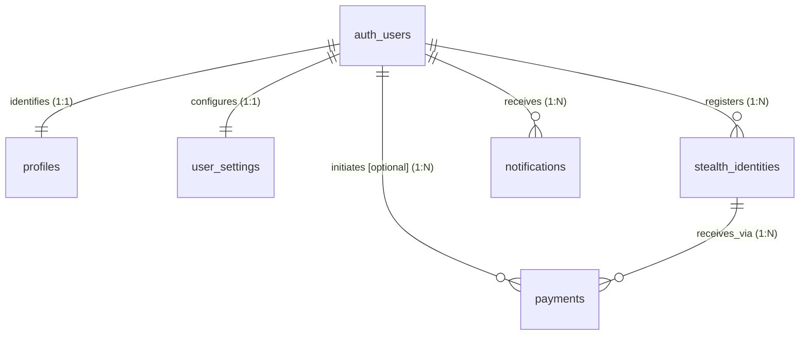

# Stealth Pay — Database Relationships & Data Ownership

> Phase 2 deliverable detailing entity relationships, foreign key constraints, deletion behaviors, and ownership models.

## 1. Ownership & Authority Model

In Stealth Pay, **Supabase Auth** (`auth.users`) is the root identity authority:
- `profiles.id` mirrors `auth.users(id)` with `ON DELETE CASCADE`.
- `user_settings.user_id` references `auth.users(id)` with `ON DELETE CASCADE` (`UNIQUE` per user).
- `stealth_identities.user_id` references `auth.users(id)` with `ON DELETE CASCADE`.
- `notifications.user_id` references `auth.users(id)` with `ON DELETE CASCADE`.

## 2. Stealth Payment Relationships

A payment row in `payments` ties together senders, receivers, and the ERC-5564 derivation:

### Foreign Key Constraints & Cascades
- `payments.sender_user_id` -> `auth.users(id) ON DELETE SET NULL`
  - If a sender deletes their account, payment history preserves accounting integrity while unlinking user metadata.
- `payments.receiver_identity_id` -> `stealth_identities(id) ON DELETE RESTRICT`
  - A receiver cannot delete an active stealth identity if payments have been received or are pending against it.
- `notifications.user_id` -> `auth.users(id) ON DELETE CASCADE`
  - Deleting an account removes pending notifications.
