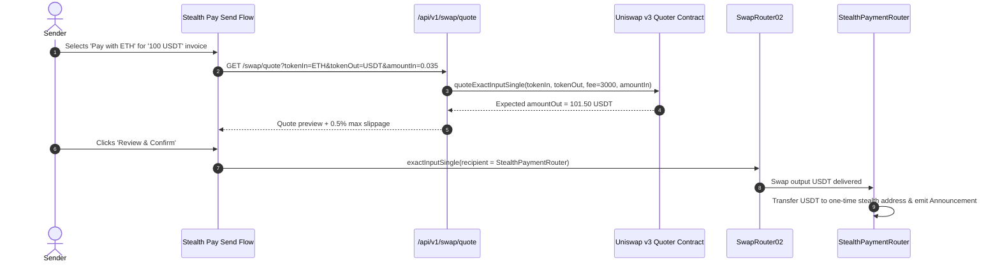

# Uniswap v3 Pre-Payment Swap Integration

## 1. Overview
In global commerce, senders frequently hold assets (such as ETH, WBT, or USDC) that differ from what the receiver's invoice specifies (typically USDT). 

Instead of forcing senders to manually visit an external decentralized exchange, swap tokens, return to Stealth Pay, and then pay, Stealth Pay embeds **Uniswap v3 pre-payment swapping** directly into the payment flow.

---

## 2. Swap Architecture & Flow

---

## 3. Slippage & Security Protections
- **Protected Slippage:** The client enforces a strict `0.5%` slippage tolerance. If price volatility exceeds this threshold, the transaction safely reverts.
- **Deadline Guard:** Swaps include a 20-minute execution deadline preventing transactions from getting stuck in the mempool.
